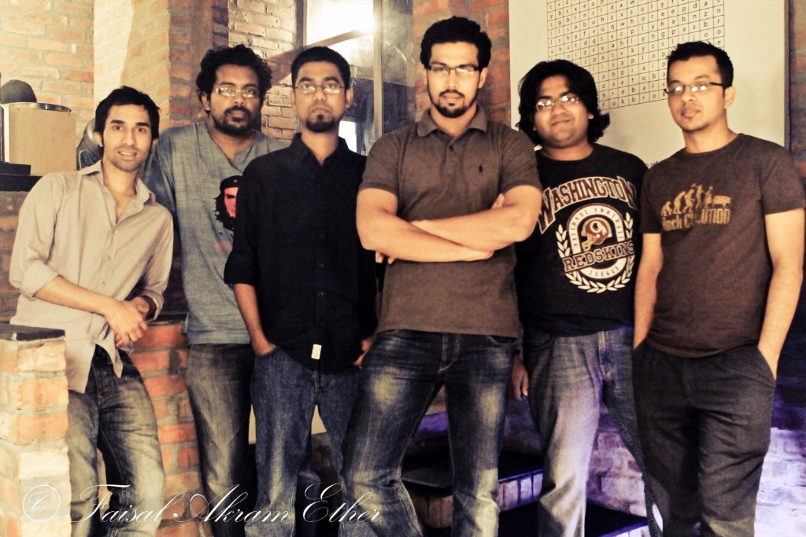

# 🎸 Icons

[](https://github.com/GhostDog45/BD-Band-Music) [](#) [](#) [](#)

<p align="center">
  
</p>

## 🌟 About the Band

> **Icons** (also known early on as *The Icons*) is an influential Bangladeshi alternative rock and heavy metal band formed in Dhaka featuring M. Muntasir Hossain Rizu (Vocals & Guitar), Shawkat Ahmed Siddiky (Guitar), Amit Muntasir (Bass), and Aushi Omar (Drums), with primary lyricist Faisal Akram Ether. Rising to prominence in the mid-2000s underground movement through mixed albums like *Din Bodol* and *Agontuk 3*, the band released their landmark debut studio album *Ishshoronio* in 2005.

---

## 📑 Discography Index

1. [Ishshoronio (ঈশ্বরণীয়) (2005)](#1-ishshoronio-2005)

### 💿 Mixed Albums
2. [Din Bodol (দিন বদল) (2004)](#2-din-bodol-2004)
3. [Agontuk 3 (আগন্তুক ৩) (2005)](#3-agontuk-3-2005)
4. [Hatiar (হাতিয়ার) (2012)](#4-hatiar-2012)

---

<a id="1-ishshoronio-2005"></a>
## 1. Ishshoronio (ঈশ্বরণীয়) (2005)

- **Album:** Ishshoronio (ঈশ্বরণীয়)
- **Release Year:** 2005 (July 15, 2005)
- **Record Label:** G-Series
- **Audio Quality:** Lossless FLAC (16-bit / 44.1 kHz)

<p align="center">
  
</p> (ঈশ্বরণীয়)
- **Release Year:** 2005 (July 15, 2005)
- **Record Label:** G-Series
- **Audio Quality:** Lossless FLAC (16-bit / 44.1 kHz)

### 📖 About the Album
Released on July 15, 2005 under G-Series, *Ishshoronio* is the acclaimed debut studio album by Icons. Blending atmospheric alternative metal with deeply poetic Bengali lyrics penned by Faisal Akram Ether, the 12-track album delivered underground classics including *"Brishtihoto"*, *"Ishshoronio"*, *"[O]shompurno"*, and *"Obinoy"*.

### 🎵 Tracklist (One-Tap Download)

- [**01 - Brishtihoto (বৃষ্টিহত)**](https://media.githubusercontent.com/media/GhostDog45/Icons/master/Ishshoronio%20%282005%29/01%20-%20Brishtihoto.flac?download=true) &nbsp; [](https://media.githubusercontent.com/media/GhostDog45/Icons/master/Ishshoronio%20%282005%29/01%20-%20Brishtihoto.flac?download=true)
- [**02 - Shottoy (সত্যয়)**](https://media.githubusercontent.com/media/GhostDog45/Icons/master/Ishshoronio%20%282005%29/02%20-%20Shottoy.flac?download=true) &nbsp; [](https://media.githubusercontent.com/media/GhostDog45/Icons/master/Ishshoronio%20%282005%29/02%20-%20Shottoy.flac?download=true)
- [**03 - Oporanho (অপরাহ্ন)**](https://media.githubusercontent.com/media/GhostDog45/Icons/master/Ishshoronio%20%282005%29/03%20-%20Oporanho.flac?download=true) &nbsp; [](https://media.githubusercontent.com/media/GhostDog45/Icons/master/Ishshoronio%20%282005%29/03%20-%20Oporanho.flac?download=true)
- [**04 - Neo (নিও)**](https://media.githubusercontent.com/media/GhostDog45/Icons/master/Ishshoronio%20%282005%29/04%20-%20Neo.flac?download=true) &nbsp; [](https://media.githubusercontent.com/media/GhostDog45/Icons/master/Ishshoronio%20%282005%29/04%20-%20Neo.flac?download=true)
- [**05 - Ishshoronio (ঈশ্বরণীয়)**](https://media.githubusercontent.com/media/GhostDog45/Icons/master/Ishshoronio%20%282005%29/05%20-%20Ishshoronio.flac?download=true) &nbsp; [](https://media.githubusercontent.com/media/GhostDog45/Icons/master/Ishshoronio%20%282005%29/05%20-%20Ishshoronio.flac?download=true)
- [**06 - [O]shompurno ([অ]সম্পূর্ণ)**](https://media.githubusercontent.com/media/GhostDog45/Icons/master/Ishshoronio%20%282005%29/06%20-%20%5BO%5Dshompurno.flac?download=true) &nbsp; [](https://media.githubusercontent.com/media/GhostDog45/Icons/master/Ishshoronio%20%282005%29/06%20-%20%5BO%5Dshompurno.flac?download=true)
- [**07 - Utshorgo (উৎসর্গ)**](https://media.githubusercontent.com/media/GhostDog45/Icons/master/Ishshoronio%20%282005%29/07%20-%20Utshorgo.flac?download=true) &nbsp; [](https://media.githubusercontent.com/media/GhostDog45/Icons/master/Ishshoronio%20%282005%29/07%20-%20Utshorgo.flac?download=true)
- [**08 - Oshomo (অসমো)**](https://media.githubusercontent.com/media/GhostDog45/Icons/master/Ishshoronio%20%282005%29/08%20-%20Oshomo.flac?download=true) &nbsp; [](https://media.githubusercontent.com/media/GhostDog45/Icons/master/Ishshoronio%20%282005%29/08%20-%20Oshomo.flac?download=true)
- [**09 - Sporsho (স্পর্শ)**](https://media.githubusercontent.com/media/GhostDog45/Icons/master/Ishshoronio%20%282005%29/09%20-%20Sporsho.flac?download=true) &nbsp; [](https://media.githubusercontent.com/media/GhostDog45/Icons/master/Ishshoronio%20%282005%29/09%20-%20Sporsho.flac?download=true)
- [**10 - Mrito (মৃত)**](https://media.githubusercontent.com/media/GhostDog45/Icons/master/Ishshoronio%20%282005%29/10%20-%20Mrito.flac?download=true) &nbsp; [](https://media.githubusercontent.com/media/GhostDog45/Icons/master/Ishshoronio%20%282005%29/10%20-%20Mrito.flac?download=true)
- [**11 - Snato (স্নাতো)**](https://media.githubusercontent.com/media/GhostDog45/Icons/master/Ishshoronio%20%282005%29/11%20-%20Snato.flac?download=true) &nbsp; [](https://media.githubusercontent.com/media/GhostDog45/Icons/master/Ishshoronio%20%282005%29/11%20-%20Snato.flac?download=true)
- [**12 - Obinoy (অবিনয়)**](https://media.githubusercontent.com/media/GhostDog45/Icons/master/Ishshoronio%20%282005%29/12%20-%20Obinoy.flac?download=true) &nbsp; [](https://media.githubusercontent.com/media/GhostDog45/Icons/master/Ishshoronio%20%282005%29/12%20-%20Obinoy.flac?download=true)

### 🖼️ Album Artwork

| | |
| :---: | :---: |
| <br><sub><b>1. Front Cover</b></sub> | <br><sub><b>2. Booklet (Part 1)</b></sub> |
| <br><sub><b>3. Booklet (Part 2)</b></sub> | <br><sub><b>4. Booklet (Part 3)</b></sub> |
| <br><sub><b>5. Booklet (Part 4)</b></sub> | <br><sub><b>6. Booklet (Part 5)</b></sub> |
| <br><sub><b>7. Promotional Poster & Lyrics</b></sub> | <br><sub><b>8. Inset (Front)</b></sub> |
| <br><sub><b>9. Band Photography</b></sub> | <br><sub><b>10. Compact Disc (CD)</b></sub> |
| <br><sub><b>11. Back Inset</b></sub> | <br><sub><b>12. Back Cover</b></sub> |
| <br><sub><b>13. folder</b></sub> |  |

---

<a id="2-din-bodol-2004"></a>
## 2. [Din Bodol (দিন বদল) (2004)](https://github.com/GhostDog45/Mixed-Albums#6-din-bodol-2004)

### 🎵 Tracklist (One-Tap Download)

- [**The Icons - Nishpap Oporadh**](https://media.githubusercontent.com/media/GhostDog45/Mixed-Albums/master/Din%20Bodol%20%282004%29/09.%20Nishpap%20Oporadh.flac?download=true) &nbsp; [](https://media.githubusercontent.com/media/GhostDog45/Mixed-Albums/master/Din%20Bodol%20%282004%29/09.%20Nishpap%20Oporadh.flac?download=true)

---

<a id="3-agontuk-3-2005"></a>
## 3. [Agontuk 3 (আগন্তুক ৩) (2005)](https://github.com/GhostDog45/Mixed-Albums#7-agontuk-3-2005)

### 🎵 Tracklist (One-Tap Download)

- [**Icons - Avinoy**](https://media.githubusercontent.com/media/GhostDog45/Mixed-Albums/master/Agontuk%203%20%282005%29/06%20Avinoy.flac?download=true) &nbsp; [](https://media.githubusercontent.com/media/GhostDog45/Mixed-Albums/master/Agontuk%203%20%282005%29/06%20Avinoy.flac?download=true)

---

<a id="4-hatiar-2012"></a>
## 4. [Hatiar (হাতিয়ার) (2012)](https://github.com/GhostDog45/Mixed-Albums#17-hatiar-2012)

### 🎵 Tracklist (One-Tap Download)

- [**Icons - Obosheshe**](https://media.githubusercontent.com/media/GhostDog45/Mixed-Albums/master/Hatiar%20%282012%29/02%20Obosheshe.wav?download=true) &nbsp; [](https://media.githubusercontent.com/media/GhostDog45/Mixed-Albums/master/Hatiar%20%282012%29/02%20Obosheshe.wav?download=true)

---

### 💾 Git LFS & Downloading Audio
All audio tracks in this repository are managed via **Git LFS** (Large File Storage).
- **One-Tap Direct Download:** Click either the track title or the green download button next to any song to instantly save the file to your device.
- **To clone locally with all audio files:**
  ```bash
  git lfs install
  git clone https://github.com/GhostDog45/Icons.git
  ```

---

### 🙏 Special Thanks & Gratitude
Heartfelt gratitude to **Shohail Ibne Mahbub (XTR)** for his monumental passion and dedication in keeping Bangladeshi band music alive. Through his archival project [**Bangla CD Covers**](https://banglacdcovers.blogspot.com/), he has painstakingly collected, preserved, and scanned original physical CDs and cassette tapes, ensuring that the legacy, artwork, and history of Bangladesh's rock and band movement remain preserved for generations of music lovers.
